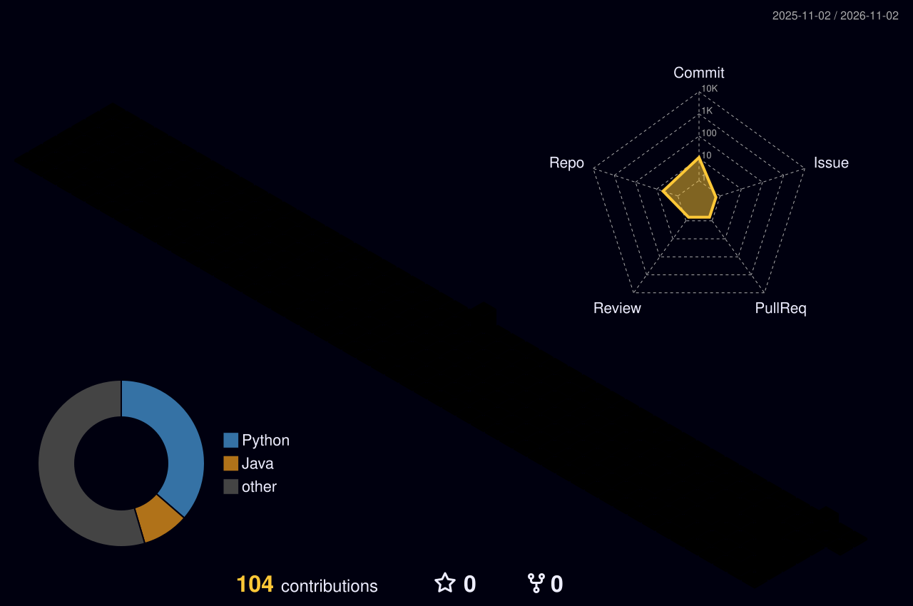

[About](#-about-me) · [Experience](#-professional-experience) · [Featured Systems](#-featured-systems--architecture) · [Skills](#-technical-arsenal) · [Telemetry](#-engineering-telemetry) · [Contact](#-connect--collaborate)

**`⏱ 2+ Yrs Shipping Production Systems` · `🧪 90%+ Test Coverage Held` · `📉 −30% Code Footprint (Atomic UI)` · `☸️ CKAD-Track Kubernetes` · `🎓 9.2 GPA`**

---

## 📌 About Me

I am a **Software Engineer** specializing in **backend microservices, distributed architectures, and autonomous AI systems**. With an engineering foundation spanning both modern frontend and high-throughput backend design, I build reliable, production-tested APIs, event-driven pipelines, and LLM-powered multi-agent frameworks.

- 🔭 **Current Focus**: Architecting high-throughput Java microservices and prompt optimization pipelines at **Capgemini (Nuuday Telecom)**.
- ⚙️ **Core Philosophy**: Clean separation of concerns, defensive runtime boundaries, contract-first APIs, and high test coverage.
- 🎓 **Education & Certifications**:
  - **B.Tech in Computer Science & Business Systems** · SRM Institute of Science and Technology · `9.2 GPA`
  - **Kubernetes Application Developer (CKAD-Track)** · KodeKloud
  - **Spring Boot Microservices 5-in-1** (Boot · Cloud · Docker · K8s)
  - **Meta Front-End Developer Professional** · Coursera

---

## 💼 Professional Experience

### **Backend Software Engineer** · `Capgemini (Nuuday Telecom)`
*2025 – Present · Bengaluru, India*
- **Prompt Evaluation & Optimization Engine**: Engineered multi-threaded Java pipelines that evaluate, version, and optimize AI prompts—significantly reducing text processing overhead and LLM latency.
- **Enterprise Quality & Thread Safety**: Built a comprehensive JUnit 5 and Mockito test suite; enforced SonarQube quality gates that prevent memory leaks and concurrency race conditions, holding a **90%+ test coverage standard**.
- **Containerization & CI/CD**: Packaged services using Docker and automated builds via Jenkins and Maven pipelines for seamless multi-environment deployments.

### **Software Engineer (Frontend / Full-Stack)** · `Bhrish Labs × Nestlé`
*2024 – 2025*
- **Enterprise HR Requisition Platform Refactor**: Re-architected core user workflows following Atomic Design principles (atoms → molecules → organisms), eliminating redundant components and cutting total code footprint by **−30%**.
- **State Management & Form Wizardry**: Implemented robust multi-step form state management using custom React hooks and the Context API.
- **Runtime Optimization**: Resolved critical DOM bottlenecks by introducing debounced search inputs, efficient pagination, and route-level lazy loading.

## 🚀 Featured Systems & Architecture

A selection of real, production-ready systems and open-source architectures I have designed and built:

### 1. [Supply-Chain-Copilot](https://github.com/Harshabobbiti626/Supply-Chain-Copilot)
> **Enterprise Event-Driven Logistics Disruption & Route Optimization Platform**
- **Architecture**: Java 21 & Spring Boot 3 backend utilizing ACID pessimistic locking and the transactional outbox pattern to guarantee zero dual-write inconsistencies during shipment state transitions.
- **Intelligence & Optimization**: Integrates Google OR-Tools MILP solver for constrained vehicle rerouting alongside Gemini 2.5 Flash with continuous vector RAG for logistics disruption diagnosis.
- **Real-Time Visualization**: Interactive React 19 geospatial Leaflet canvas streaming real-time dispatch updates via STOMP WebSockets.
- **Stack**: `Java 21` · `Spring Boot 3` · `Google OR-Tools` · `Gemini 2.5 Flash` · `Vector RAG` · `React 19` · `Leaflet` · `STOMP WebSockets`

### 2. [Software-Team-MAS (Multi-Agent Systems)](https://github.com/Harshabobbiti626/Software-Team-MAS-Multi-Agent-Systems)
> **Autonomous Multi-Agent Software Engineering Framework**
- **Architecture**: Enterprise multi-agent framework mirroring a full engineering org with contract-first parallel pods (Architect, Coder, Tester, Reviewer).
- **Execution & State**: Powered by LangGraph DAG orchestration, 4-tier memory hierarchy, Git blackboard for shared state, OpenTelemetry distributed tracing, and automated Root-Cause Analysis (RCA) with a live Mission Control dashboard.
- **Stack**: `Python` · `LangGraph` · `OpenTelemetry` · `DAG Orchestration` · `Multi-Agent Systems`

### 3. [Tech-Sovereignty-Graph](https://github.com/Harshabobbiti626/Tech-Sovereignty-Graph)
> **Enterprise Identity Governance & Toxic Permission Detection Engine**
- **Architecture**: Graph-powered security application mapping complex identity access paths, nested group inheritances, and resource dependencies.
- **Security Intelligence**: Detects hidden Shadow IT vulnerabilities, calculates blast radiuses, and flags toxic permission escalation chains in real time.
- **Stack**: `Java` · `Spring Boot` · `Graph Algorithms` · `Neo4j / Relational Graph` · `REST API`

### 4. [Autonomous-Customer-Support-Agent](https://github.com/Harshabobbiti626/Autonomous-Customer-Support-Agent)
> **Stateful Enterprise AI Customer Support Agent with HITL**
- **Architecture**: Stateful AI agent built with LangGraph featuring parameterized tool execution and deterministic safety guardrails.
- **Safety**: Integrates Human-in-the-Loop (HITL) supervisor breakpoints for high-consequence customer transactions and session state persistence.
- **Stack**: `Python` · `LangGraph` · `Tool Calling` · `HITL Guardrails` · `Pydantic`

### 5. [Self-Healing-RAG-Knowledge-Base](https://github.com/Harshabobbiti626/Self-Healing-RAG-Knowledge-Base)
> **Dual-Loop Self-Healing Retrieval-Augmented Generation (RAG)**
- **Architecture**: Closed dual-loop RAG architecture combining Fast-Loop query correction (Corrective RAG, HyDE query expansion, NLI Grounding Guard) with Slow-Loop autonomous knowledge base repair, contradiction auditing, and index curation.
- **Stack**: `Python` · `CRAG` · `HyDE` · `Vector Embeddings` · `NLI Grounding Guard`

### 6. [Cloud-Native-Metrics-Monitoring-Pipeline](https://github.com/Harshabobbiti626/Cloud-Native-Metrics-Monitoring-Pipeline)
> **High-Throughput Metric Ingestion Engine**
- **Architecture**: High-throughput Java ingestion engine utilizing the Streams API and thread-safe concurrency models to parse and aggregate server performance metrics.
- **Quality**: Enforces automated SonarQube and Checkstyle quality gates; containerized with Docker.
- **Stack**: `Java` · `Streams API` · `Multithreading` · `SonarQube` · `Docker`

### 7. [Redis-Backed-URL-Shortener-Service](https://github.com/Harshabobbiti626/Redis-Backed-URL-Shortener-Service)
> **High-Performance Caching & Routing Microservice**
- **Architecture**: Containerized Spring Boot URL routing engine using Redis cache-aside caching to eliminate database read bottlenecks under high concurrency.
- **Stack**: `Java` · `Spring Boot` · `Redis` · `PostgreSQL` · `Docker`

---

## 🛠️ Technical Arsenal

 

 

| Domain | Technologies & Methodologies |
| :--- | :--- |
| **Backend & Microservices** | Java 17/21, Spring Boot 3, Spring Data JPA, Hibernate, Node.js (Express), RESTful APIs, Microservices Architecture, Transactional Outbox Pattern |
| **Cloud & DevOps** | Docker, Kubernetes (CKAD-Track), Azure (AKS), AWS, Terraform, Jenkins, Maven, GitHub Actions, Linux |
| **Databases & Caching** | PostgreSQL, MySQL, Redis, MongoDB, Neo4j, pgvector, RDBMS Query & Index Optimization |
| **AI & Agentic Systems** | LangGraph, CrewAI, Function / Tool Calling, Multi-Agent Orchestration, Corrective RAG (CRAG), HyDE, Vector Embeddings |
| **Frontend & UI** | React 19, TypeScript, Context API, Redux Toolkit, Atomic Design, Tailwind CSS, STOMP WebSockets |
| **Quality & Observability** | JUnit 5, Mockito, SonarQube, OpenTelemetry, Jest, Vitest, Playwright E2E, Checkstyle |

---

## 📊 Engineering Telemetry

  

<b>3D CONTRIBUTION SKYLINE</b> — Automated nightly build via GitHub Actions

  

<picture>
  <source media="(prefers-color-scheme: dark)" srcset="./profile-3d-contrib/profile-night-rainbow.svg" />
  <source media="(prefers-color-scheme: light)" srcset="./profile-3d-contrib/profile-season-animate.svg" />
  
</picture>

## 📬 Connect & Collaborate

**Open to discussions around backend microservices, distributed architectures, and agentic AI systems.**

 

&nbsp;

&nbsp;

&nbsp;

 

📍 Bengaluru, Karnataka · India

  

