 

 

&nbsp;

&nbsp;

&nbsp;

  

[About](#-about-me) · [Experience](#-professional-experience) · [Featured Systems](#-featured-systems--architecture) · [Skills](#-technical-arsenal) · [Telemetry](#-engineering-telemetry) · [Contact](#-connect--collaborate)

**`⏱ 2+ Yrs Shipping Production Systems` · `🧪 90%+ Test Coverage Held` · `📉 −30% Code Footprint (Atomic UI)` · `☸️ CKAD-Track Kubernetes` · `🎓 9.2 GPA`**

## 📌 About Me

I am a **Software Engineer** specializing in **backend microservices, distributed architectures, and autonomous AI systems**. With an engineering foundation spanning both modern frontend and high-throughput backend design, I build reliable, production-tested APIs, event-driven pipelines, and LLM-powered multi-agent frameworks.

- 🔭 **Current Focus**: Architecting high-throughput Java microservices and prompt optimization pipelines at **Capgemini (Nuuday Telecom)**.
- ⚙️ **Core Philosophy**: Clean separation of concerns, defensive runtime boundaries, contract-first APIs, and high test coverage.
- 🎓 **Education & Certifications**:
  - **B.Tech in Computer Science & Business Systems** · SRM Institute of Science and Technology · `9.2 GPA`
  - **Kubernetes Application Developer (CKAD-Track)** · KodeKloud
  - **Spring Boot Microservices 5-in-1** (Boot · Cloud · Docker · K8s)
  - **Meta Front-End Developer Professional** · Coursera

---

## 💼 Professional Experience

### **Backend Software Engineer** · `Capgemini (Nuuday Telecom)`
*2025 – Present · Bengaluru, India*
- **Prompt Evaluation & Optimization Engine**: Engineered multi-threaded Java pipelines that evaluate, version, and optimize AI prompts—significantly reducing text processing overhead and LLM latency.
- **Enterprise Quality & Thread Safety**: Built a comprehensive JUnit 5 and Mockito test suite; enforced SonarQube quality gates that prevent memory leaks and concurrency race conditions, holding a **90%+ test coverage standard**.
- **Containerization & CI/CD**: Packaged services using Docker and automated builds via Jenkins and Maven pipelines for seamless multi-environment deployments.

### **Software Engineer (Frontend / Full-Stack)** · `Bhrish Labs × Nestlé`
*2024 – 2025*
- **Enterprise HR Requisition Platform Refactor**: Re-architected core user workflows following Atomic Design principles (atoms → molecules → organisms), eliminating redundant components and cutting total code footprint by **−30%**.
- **State Management & Form Wizardry**: Implemented robust multi-step form state management using custom React hooks and the Context API.
- **Runtime Optimization**: Resolved critical DOM bottlenecks by introducing debounced search inputs, efficient pagination, and route-level lazy loading.

## 🚀 Featured Systems & Architecture

<table>
<tr>
<td width="50%" valign="top">

### 🚚 [Supply-Chain-Copilot](https://github.com/Harshabobbiti626/Supply-Chain-Copilot)
**Enterprise Logistics Disruption & Route Optimization Platform**

- **Backend Engine**: Java 21 & Spring Boot 3 with ACID pessimistic locking & transactional outbox pattern to eliminate dual-write hazards.
- **Optimization & AI**: Google OR-Tools MILP solver for constrained vehicle rerouting + Gemini 2.5 Flash with continuous vector RAG.
- **Geospatial Canvas**: Real-time Leaflet canvas streamed via STOMP WebSockets.

`Java 21` · `Spring Boot 3` · `Google OR-Tools` · `Gemini 2.5` · `React 19`

</td>
<td width="50%" valign="top">

### 🤖 [Software-Team-MAS](https://github.com/Harshabobbiti626/Software-Team-MAS-Multi-Agent-Systems)
**Autonomous Multi-Agent Software Engineering Framework**

- **Org Topology**: Contract-first parallel agent pods (Architect, Coder, Tester, Reviewer) mirroring an engineering organization.
- **State & Memory**: LangGraph DAG orchestration, 4-tier memory hierarchy, and Git blackboard for shared state.
- **Observability**: OpenTelemetry distributed tracing with a live Mission Control dashboard.

`Python` · `LangGraph` · `OpenTelemetry` · `Multi-Agent`

</td>
</tr>
<tr>
<td width="50%" valign="top">

### 🛡️ [Tech-Sovereignty-Graph](https://github.com/Harshabobbiti626/Tech-Sovereignty-Graph)
**Identity Governance & Blast Radius Analysis Engine**

- **Access Topology**: Maps nested group inheritances, access paths, and cloud resource dependencies across enterprise tenants.
- **Risk Detection**: Flags Shadow IT risks and toxic permission escalation chains in real time using graph algorithms.

`Java` · `Spring Boot` · `Graph Algorithms` · `Neo4j`

</td>
<td width="50%" valign="top">

### 🧠 [Self-Healing-RAG-Base](https://github.com/Harshabobbiti626/Self-Healing-RAG-Knowledge-Base)
**Dual-Loop Self-Healing RAG Architecture**

- **Dual-Loop Correction**: Fast-Loop query correction (CRAG, HyDE, NLI Grounding Guard) + Slow-Loop autonomous knowledge contradiction auditing.
- **Index Curation**: Automated embedding repair and drift mitigation.

`Python` · `CRAG` · `HyDE` · `Vector Embeddings` · `NLI`

</td>
</tr>
<tr>
<td width="50%" valign="top">

### 💬 [Autonomous-Support-Agent](https://github.com/Harshabobbiti626/Autonomous-Customer-Support-Agent)
**Stateful Enterprise AI Support with Human-in-the-Loop**

- **Deterministic Guardrails**: Parameterized tool execution preventing hallucinated API mutations.
- **HITL Checkpoints**: Supervisor approval breakpoints for high-consequence customer operations.

`Python` · `LangGraph` · `Tool Calling` · `HITL Guardrails`

</td>
<td width="50%" valign="top">

### ⚡ [Cloud-Native-Metrics](https://github.com/Harshabobbiti626/Cloud-Native-Metrics-Monitoring-Pipeline)
**High-Throughput Server Metric Ingestion Engine**

- **Performance**: Streams API & thread-safe concurrency parsing server metrics with sub-millisecond overhead.
- **Quality Gates**: Automated SonarQube & Checkstyle compliance; containerized with Docker.

`Java` · `Streams API` · `Multithreading` · `SonarQube` · `Docker`

</td>
</tr>
<tr>
<td width="50%" valign="top">

### 🔗 [Redis-Backed-Shortener](https://github.com/Harshabobbiti626/Redis-Backed-URL-Shortener-Service)
**High-Performance Caching & Routing Microservice**

- **Cache-Aside Architecture**: Containerized Spring Boot routing engine using Redis caching to eliminate database read bottlenecks under high load.
- **Data Integrity**: PostgreSQL persistence with connection pooling.

`Java` · `Spring Boot` · `Redis` · `PostgreSQL` · `Docker`

</td>
<td width="50%" valign="top">

### 🔬 [Self-Pruning-Neural-Net](https://github.com/Harshabobbiti626/Self-pruning-neural-network)
**Autodiff Engine & Sparse Inference from Scratch**

- **Engine**: Pure NumPy reverse-mode autodiff engine with first-order Taylor saliency pruning.
- **Sparse Speedup**: True CSR sparse inference achieving **90% sparsity** and **9.94x FLOP reduction**.

`Python` · `NumPy` · `Autodiff` · `Sparse Inference`

</td>
</tr>
</table>

## 🛠️ Technical Arsenal

 

 

| Domain | Technologies & Methodologies |
| :--- | :--- |
| **Backend & Microservices** | Java 17/21, Spring Boot 3, Spring Data JPA, Hibernate, Node.js (Express), RESTful APIs, Microservices Architecture, Transactional Outbox Pattern |
| **Cloud & DevOps** | Docker, Kubernetes (CKAD-Track), Azure (AKS), AWS, Terraform, Jenkins, Maven, GitHub Actions, Linux |
| **Databases & Caching** | PostgreSQL, MySQL, Redis, MongoDB, Neo4j, pgvector, RDBMS Query & Index Optimization |
| **AI & Agentic Systems** | LangGraph, CrewAI, Function / Tool Calling, Multi-Agent Orchestration, Corrective RAG (CRAG), HyDE, Vector Embeddings |
| **Frontend & UI** | React 19, TypeScript, Context API, Redux Toolkit, Atomic Design, Tailwind CSS, STOMP WebSockets |
| **Quality & Observability** | JUnit 5, Mockito, SonarQube, OpenTelemetry, Jest, Vitest, Playwright E2E, Checkstyle |

## 📊 Engineering Telemetry

&nbsp;

  

  

<b>🌌 View 3D Contribution Skyline (Rebuilt Nightly via GitHub Actions)</b>

 

  

## 📬 Connect & Collaborate

**Open to discussions around backend microservices, distributed architectures, and agentic AI systems.**

 

&nbsp;

&nbsp;

&nbsp;

 

📍 Bengaluru, Karnataka · India

